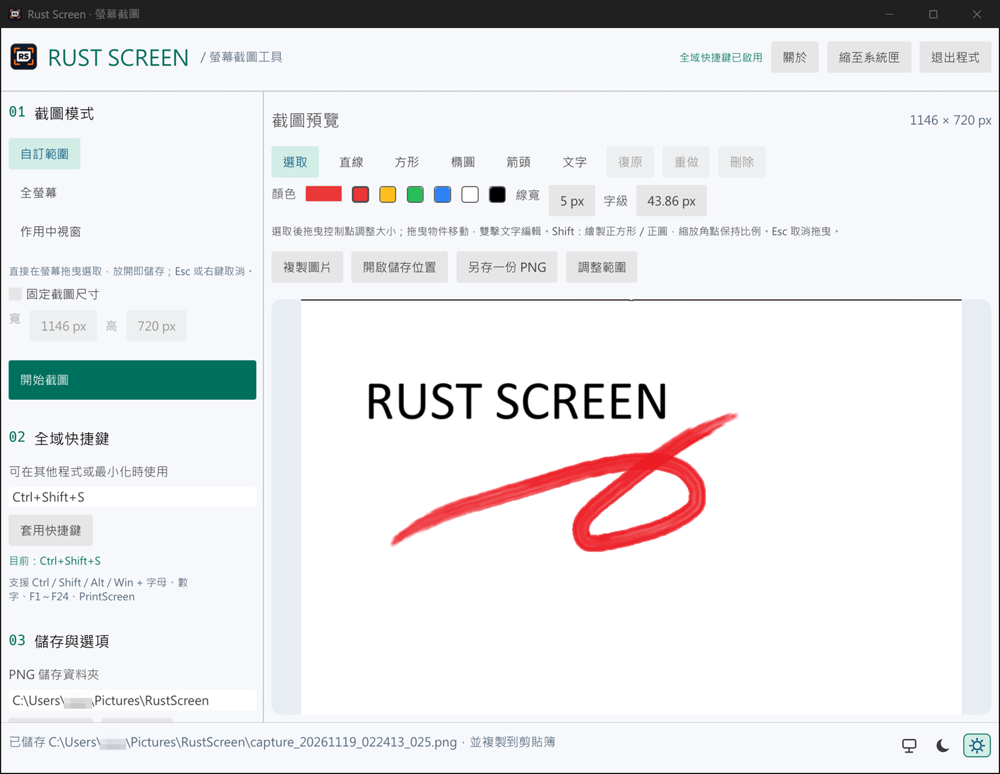

# rust-screen-web

[Rust Screen](https://github.com/showdong7/rust-screen) 的一頁式介紹網站，網址：<https://rust-screen.fujin365.cc/>

Rust Screen 是以 Rust 製作的 Windows 10 / 11 截圖工具：全域快捷鍵、跨螢幕拖曳選取、放開即存 PNG、預覽內標註與馬賽克／模糊遮蔽、浮水印、釘選到桌面，並附 MCP 伺服器讓 AI 助理也能截圖。這個 repo 只放網站，程式原始碼與執行檔在 [showdong7/rust-screen](https://github.com/showdong7/rust-screen)。

<picture>
  <source media="(prefers-color-scheme: dark)" srcset="assets/shot-main-dark.png">
  
</picture>

## 內容

| 區塊 | 說明 |
|---|---|
| 首頁 | 標語、下載與 MCP 按鈕、App 主視窗實際截圖 |
| 截圖模式 | 自訂範圍、全螢幕、作用中視窗 |
| 功能 | 馬賽克與模糊、先編輯再儲存、文字浮水印、釘選到桌面、全域快捷鍵、系統匣常駐等 12 項 |
| 標註 | 預覽區實際截圖（示範以馬賽克與模糊遮蔽金鑰和密碼），以及可在網頁上試畫的互動畫布 |
| AI · MCP | `rust-screen-mcp.exe` 的 6 個工具、Claude Code / Claude Desktop 註冊方式、使用範例與隱私提醒 |
| 使用流程 | 四步截圖與常用按鍵 |
| 下載 | 主程式與 MCP 伺服器的下載連結、系統需求與目前限制 |
| 常見問題 | 系統匣、快捷鍵、版本查詢、MCP 更新等 |

網頁右上角可切換 System / Dark / Light 主題（記在瀏覽器的 `localStorage`），App 截圖會跟著切換深色或淺色版本。

## 檔案結構

```
index.html    頁面內容（繁體中文）
styles.css    樣式與深淺色主題
script.js     主題切換、分頁、複製按鈕、標註示範畫布
favicon.ico
assets/
  icon.png                    App 圖示
  shot-main-{dark,light}.png  主視窗截圖（1584 × 1132）
  shot-annotate-{dark,light}.png  預覽與標註工具列截圖（1234 × 942）
CNAME         GitHub Pages 自訂網域
```

純靜態 HTML / CSS / JavaScript，沒有建置步驟，也沒有外部相依套件。

## 本機預覽

直接用瀏覽器開啟 `index.html` 即可；若要模擬實際網址，可在此資料夾啟動任一靜態伺服器，例如：

```powershell
python -m http.server 5180
```

再開啟 <http://localhost:5180/>。

## 部署

推送到 `master` 後，GitHub Pages 會自動從 repo 根目錄發佈，通常一分鐘內生效。

- 自訂網域由 `CNAME` 檔設定為 `rust-screen.fujin365.cc`
- DNS 在 Cloudflare：`rust-screen` 的 CNAME 指向 `showdong7.github.io`，Proxy 關閉（DNS only）

## 更新網站時

- **新版本發佈**：下載連結指向 GitHub Release 的 zip（目前是 `v0.10.0-beta`）。發佈新版後，請更新 `index.html` 中的 Release 網址、版本號（`V0.10.0 beta`）與 zip 檔案大小。
- **更換 App 截圖**：深色與淺色各一張，保持相同視窗大小與內容，替換 `assets/` 中的同名檔案，並更新 `` 的 `width` / `height`。截圖中若出現使用者名稱（例如儲存路徑、狀態列），請先遮蔽再放上網站。
  - 目前的截圖（V0.10.0 beta）擷取的是一張虛構的「Acme Cloud 帳號設定」示範頁，名稱、信箱、金鑰與密碼都是假資料。
  - 拍攝時以 `RUST_SCREEN_CONFIG_DIR` 指向暫存設定資料夾，避免動到自己的設定；儲存資料夾設為 `C:\Users\Public\Pictures\RustScreen`，畫面上的路徑就不會出現使用者名稱，拍完再刪除測試產生的檔案。
  - [rust-screen](https://github.com/showdong7/rust-screen) 與 rust-screen-app 的 README 使用同一組圖片（`docs/screenshot-*.png`），更換截圖後請一併更新。Release 說明的截圖網址固定在發佈當時的 commit，不需要修改。
- **MCP 工具或參數變更**：同步更新「AI · MCP」與「常見問題」區塊的說明。
